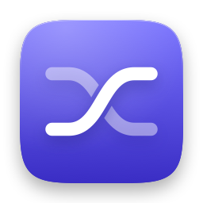
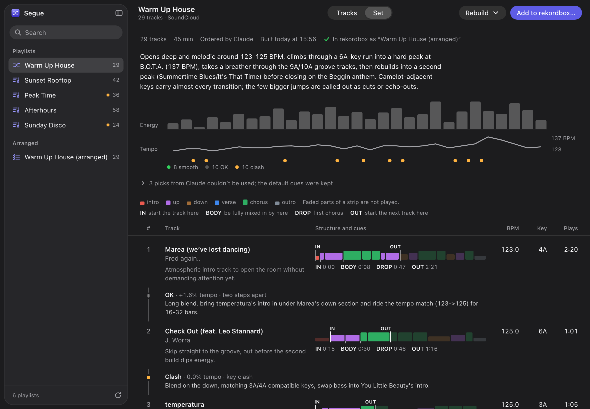
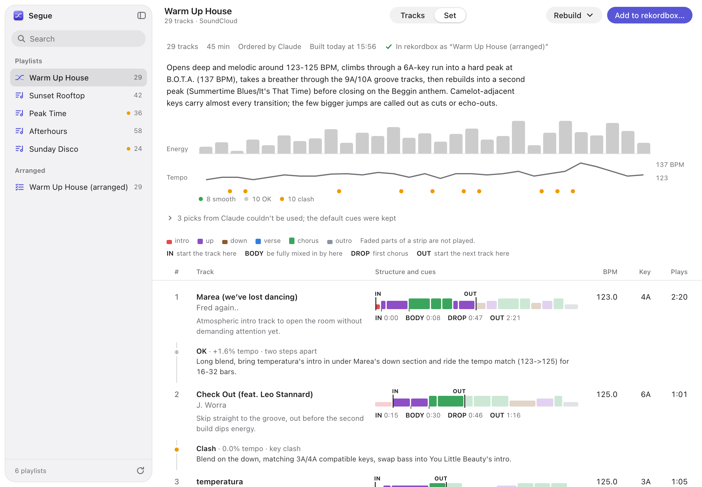
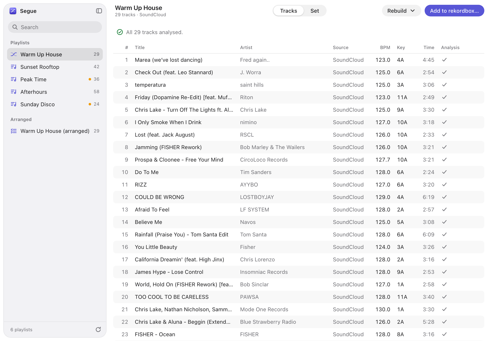

<p align="center">
  
</p>

<h1 align="center">Segue</h1>

<p align="center">
  A Mac app that turns a rekordbox playlist into an ordered DJ set, with in and out points for every track.
</p>



Segue reads a playlist from your rekordbox library, makes sure every track is analysed,
asks Claude to order the tracks and choose where to enter and leave each one, and writes
the result back into rekordbox as cue points plus a new playlist called
`<name> (arranged)`. Your original playlist is left alone.

It is a personal tool shared as source code. There is no installer and no download: you
clone the repository and build the app on your own Mac.

> [!WARNING]
> Segue writes to rekordbox's library database in a way rekordbox does not support.
> It takes a backup before every write, but you should keep your own backup of your
> library as well. Read [Disclaimers](#disclaimers) before you use it.

## What it does

1. **Lists your playlists** and shows how many tracks in each still need analysing.
2. **Analyses streaming tracks.** rekordbox only analyses a Spotify track when it is
   loaded to a deck, so Segue drives rekordbox's own keyboard shortcuts to load each
   un-analysed track in turn.
3. **Builds the set.** Claude gets each track's tempo, key, energy and phrase map
   (intro, verse, chorus, outro) and returns an order plus an in and out point for each
   track. Every pick is checked against rekordbox's phrase grid, and picks that do not
   land on a real phrase boundary are thrown away. A rules-only mode orders by energy,
   key and tempo with no Claude call.
4. **Shows the set for review**: energy and tempo curves, a rating for each transition,
   and a note on how to mix it.
5. **Adds it to rekordbox**: cues labelled `IN`, `BODY`, `DROP` and `OUT` on each track,
   and the `(arranged)` playlist in set order.

| Set view | Tracks view |
|---|---|
|  |  |

The screenshots use placeholder playlist names.

## Requirements

| You need | Notes |
|---|---|
| A Mac | Built and tested on macOS 26 on Apple silicon. Not tested on older versions or on Intel. |
| rekordbox 7 | Tested with 7.2.17, installed at `/Applications/rekordbox 7/rekordbox.app`, with the library in the default place (`~/Library/Pioneer/rekordbox`). rekordbox 6 and earlier are not tested. |
| Python 3.12 | From [python.org](https://www.python.org/downloads/) or Homebrew. Other 3.x versions may work but are not tested. |
| Claude Code | The [`claude` command](https://claude.com/claude-code), installed and logged in. Segue runs it in the background, so building a set uses your own Claude plan's usage. Not needed for the rules-only mode. |
| An internet connection | For Claude, and to look up Spotify track names. |

You do not need any API keys.

To analyse streaming tracks, macOS will also ask you to allow keyboard control. See
[Permissions](#permissions).

## Install

```bash
git clone https://github.com/akashxn/Segue.git
```

```bash
cd Segue && ./build_app.sh
```

The script creates a Python environment in `.venv`, installs the two dependencies
([pyrekordbox](https://github.com/dylanljones/pyrekordbox) and
[pywebview](https://pywebview.flowrl.com)) and builds `Segue.app` in the folder.
Double-click it to open, or drag it to the Dock.

`Segue.app` is a small launcher that runs the code from this folder. If you move the
folder, run `./build_app.sh` again. The script uses whichever `python3` is first on
your PATH.

To run without building the app:

```bash
.venv/bin/python app.py
```

## Use

1. Open rekordbox, then open Segue. Your playlists appear in the sidebar. An orange dot
   means some tracks are not analysed yet.
2. Pick a playlist. If tracks need analysing, open the same playlist in rekordbox, sort
   it by the `#` column, and click **Start Analysing** on the Tracks tab in Segue. You get a few seconds to hover
   the mouse over the first track in rekordbox's list; after that, leave the mouse and
   keyboard alone until it finishes. Clicking another app stops the run. Analysis takes
   roughly 4 to 14 seconds per track.
3. On the Set tab, click **Build with Claude** (or **Use Rules Only**). With Claude this takes about 5 to 8 minutes for 50 tracks. The
   result is saved, so the set stays the same until you choose **Rebuild → Ask Claude
   Again**.
4. Review the set, then click **Add to rekordbox…** and confirm.
5. In rekordbox, open the `(arranged)` playlist and click the `#` column to sort it into
   set order.

Shortcuts: ⌘F search, ⌘1 Tracks, ⌘2 Set, ⌘R refresh.

## Permissions

Analysing sends key presses and a mouse click to rekordbox, so macOS asks for:

- **Accessibility** (System Settings → Privacy & Security → Accessibility)
- **Automation → System Events**

The entry may be listed as **Python** instead of Segue, because the app runs a Python
script. If you only arrange playlists that rekordbox has already analysed, you can skip
both.

## What Segue changes in rekordbox

When you click **Add to rekordbox…**, Segue:

1. Quits rekordbox (it cannot be open while the library is written) and reopens it
   afterwards. rekordbox may ask you to log in to Spotify again.
2. Copies `master.db` and `masterPlaylists6.xml` to `backups/master-<date>-<time>/` in
   this folder.
3. Writes cues labelled `IN`, `BODY`, `DROP` and `OUT` to each track in the set. Only
   cues with those labels are ever replaced. Tracks that already have your own cues get
   Segue's as memory cues, so your hot cues are not touched.
4. Creates or replaces the `<name> (arranged)` playlist.

It never reorders or edits the original playlist, and never changes the rekordbox
application.

Everything else Segue does is read-only, and reads from a temporary copy of the database.

### Restoring a backup

Quit rekordbox, then copy the two files from the backup folder back over the originals:

```bash
cp backups/master-YYYYMMDD-HHMMSS/master.db backups/master-YYYYMMDD-HHMMSS/masterPlaylists6.xml ~/Library/Pioneer/rekordbox/
```

If `~/Library/Pioneer/rekordbox/` also holds a `master.db-wal` or `master.db-shm` file,
move both out of that folder before reopening rekordbox. They belong to the database you
just replaced.

Backups are full copies of your library database and are never deleted automatically.
Clear out old ones from `backups/` when you no longer need them.

## What leaves your Mac

- **To Claude (Anthropic)**, through your own Claude Code login: the title, artist,
  tempo, key, energy and phrase map of each track in the playlist you are building. No
  audio.
- **To Spotify**: requests to its public embed pages for the Spotify tracks in your
  library, to get their titles and artists (rekordbox stores these encrypted).

Nothing else is sent anywhere. The app's server listens on `127.0.0.1` only.

## Limitations

- Claude cannot hear the music. It works from rekordbox's phrase analysis and what it
  knows about the songs, so treat the set as a starting point and check the transitions
  by ear.
- Energy is an estimate (half waveform loudness, half tempo rank), not real audio analysis.
- The two-deck analyser has had little testing against rekordbox itself. If it
  misbehaves, stop it by clicking another app.
- Writing memory cues to tracks that already have cues has not been checked visually in
  rekordbox.
- Playlists over about 80 tracks may time out with Claude.
- Transition notes are shown in Segue only; they are not written into rekordbox.
- Tracks without phrase data get plain 8-bar blocks.
- Analysing relies on rekordbox's default keyboard mapping (shift + left / right to load
  to a deck). A custom mapping will break it.
- A rekordbox update can change the database format and break reading or writing.

## Troubleshooting

- **The window is empty or a step fails**: the log is at `~/Library/Logs/Segue.log`.
- **"could not find the `claude` command"**: install Claude Code and check that `claude`
  runs in Terminal. Segue looks in `~/.local/bin`, `/opt/homebrew/bin` and `/usr/local/bin`.
- **"could not read rekordbox database"**: pyrekordbox could not open the library. See
  the [pyrekordbox documentation](https://pyrekordbox.readthedocs.io) on database keys.
- **"macOS is blocking keyboard control"**: see [Permissions](#permissions).

## Development

The app is a local HTTP server (`app.py`) showing one page (`ui.html`, plain JavaScript,
no build step) in a native window. `core.py` holds the pipeline; `writecues.py` is the
only module that writes to rekordbox.

```bash
.venv/bin/python app.py --no-window --port 8765
```

runs the server alone so you can open the page in a browser.

Notes on how rekordbox stores cues, playlists and analysis files are in
[docs/rekordbox-notes.md](docs/rekordbox-notes.md). If you change anything that writes,
test it on a copy of the library first.

## Disclaimers

- Segue is an unofficial, independent project. It is not affiliated with, endorsed by or
  supported by AlphaTheta, Pioneer DJ, Spotify, SoundCloud, TIDAL or Anthropic.
  rekordbox and the other names are trademarks of their owners.
- It reads and writes rekordbox's library by reverse-engineered means. This can corrupt
  or lose library data. Use it at your own risk, and keep your own backups.
- It automates rekordbox's interface and reads Spotify's public web pages. Either may
  stop working at any time, and it is up to you to check that your use fits the terms of
  the services you use.
- It does not download, copy or redistribute any audio.
- The software is provided as is, with no warranty. See [LICENSE](LICENSE).

## Licence

[MIT](LICENSE)
